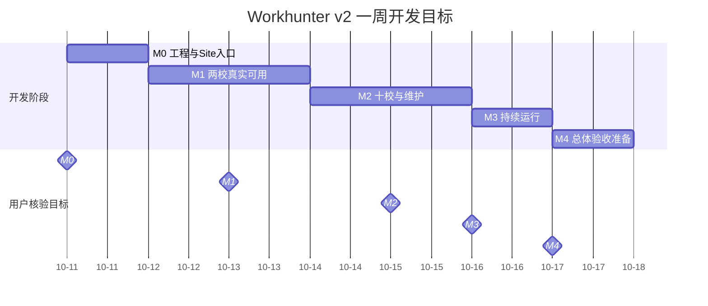

# Workhunter v2.0 一周路线图与阶段验收

**计划版本：1.3；规划日：2026-10-10；时区：Asia/Shanghai**
**开发目标窗口：2026-10-11—2026-10-17，共七天**
**仓库：[caor3693-cmyk/Workhunter-v2.0](https://github.com/caor3693-cmyk/Workhunter-v2.0)**

以下日期保留原开发目标。2026-10-11收到M0实际用户失败/阻塞，阶段未通过，三项P1见#21—#23；原工程自验日期10-10不变。统一M命名，旧S/G仅为历史映射。
Issue索引见[BOARD](BOARD.md)，当前反馈见[M0汇报](deliveries/M0-FEEDBACK-20261011.md)，M版当前核验规则见[MANUAL_QA_M](deliveries/MANUAL_QA_M.md)。原生Project仍受阻；R0治理/DOC三PR CI成功，M0修复已发布版本2并发七项复验；M1工程132条真实数据、证据/查询和原编号材料已实现；私有Site版本4同SHA可读。R5最后受影响点击/追加故障恢复受旧隔离弹窗阻塞，#11仍实施中。
2026-10-11新一轮以[对抗审查](deliveries/M0-M1-AUDIT-20261011.md)、[R0—R5执行计划](deliveries/M0-M1-EXECUTION-20261011.md)和[反馈收尾规则](deliveries/FEEDBACK_CLOSEOUT.md)为执行入口。R0—R5是本轮顺序，不是新增产品阶段。
产品继续遵循 [PRODUCT.md](PRODUCT.md) 的八项决定；字段和接口见 [CONTRACTS.md](CONTRACTS.md)，工作包详情见 [TASKS.md](TASKS.md)。
本文件以 M0—M4 安排一周进度和顺序人工核验，保留 W00—W06 工作包；新阶段门槛取代旧 R 阶段的排期表达。

## 1. 本轮交付范围

首版包含 F01—F10、D01—D08、O01—O03：学校招聘发现、准确核心字段、简要详情、更新摘要、维护网页与持续运行。
独立岗位库/搜索、全国企业直采、完整名单工程继续后置；不恢复学生账号或待遇筛选。
开发期首先在 Site 提供可使用、可反馈的版本，每个阶段完成后交付一份手工核验清单。
负责人按 M0 → M1 → M2 → M3 → M4 顺序反馈；发现问题后补建修复 Issue，修复后回到原检查项复验。
只有五个阶段均人工通过，才允许执行正式上线任务；日期到达不触发自动发布。
已修复、自动测试已通过或 PR 已合并，都不等于负责人已核验。

## 2. D1—D7 目标安排

| 日程 | 日期 | 阶段/工作包 | 当日可交付结果 | 人工核验安排 |
| --- | --- | --- | --- | --- |
| D1 | 10-11 | M0 / W00 | 工程与数据边界、最小运行入口、Site 检查入口及版本说明 | 提交 M0 清单，核对能打开、身份清楚、未完成功能标识 |
| D2 | 10-12 | M1 / W01 | 华工、广工基础发现，日期/地点证据、去重与详情补全基础 | 开发自测与进度预览；暂不宣布 M1 通过 |
| D3 | 10-13 | M1 / W02 | 两校卡片、筛选、相关性、简要详情、原文与手机可用流程 | 提交 M1 清单；反馈转修复 Issue |
| D4 | 10-14 | M2 / W03、W04 | 十校来源登记与适配、真实受限状态、维护页主要流程 | 提供进度预览；处理 M1 回归 |
| D5 | 10-15 | M2 / W03、W04 | 十校状态、补录/纠错/撤回、真实更新摘要可核验 | 提交 M2 清单 |
| D6 | 10-16 | M3 / W05 | 自然调度、断点与失败恢复、备份恢复、只读 MCP | 提交 M3 清单及真实运行证据 |
| D7 | 10-17 | M4 / W06 | Site 全流程回归、逐校说明、已知问题和正式发布准备材料 | 提交 M4 总清单；全部通过后才解锁正式上线 |

工作日期是排程目标；阶段完成当天提供版本与核验包。排期假设开发日内能获得一次集中反馈，具体时刻由负责人实际安排。
这里规定交付流程，没有设置定时提醒，也不要求负责人每天在线；无阶段交付的日期只提供进度。
每份阶段清单控制在可逐条操作的范围，建议一次 15—30 分钟；技术证据另附，避免让用户阅读原始日志。
若反馈晚到、缺陷未修好或实际工作超期，记录原目标、延迟原因与新的预计日期，后续依赖日期顺延。
没有反馈就保持“待验收”，不能以超时、沉默或日历日期代替通过。
等待反馈时继续不依赖失败部分的工作，不把整个项目无条件停住，也不跳过人工 Gate。

## 2.1 路线图视图

以下为仓库内的计划时间轴；原生 GitHub Projects Roadmap 仍待 PM-SETUP 完成。正式发布是 Gate 条件解锁项，不画成日历自动开始的任务。

## 2.2 实际进展

| 阶段 / 管理项 | 原目标 | 实际记录 | 当前结论 |
| --- | --- | --- | --- |
| M0 / W00、#6 / #1 | 2026-10-11 | 10-10保存工程初版；10-11收到M0失败/阻塞，P1 #21/#22/#23工程修复，版本2七项复验已发，当前版本4继续复验 | 未通过，Blocked/open；M0-02/M0-07失败，M0-03/M0-06阻塞，其余原项目未测 |
| M1 / W01、W02 | 2026-10-12—10-13 | 10-11提前完成R3/R4、132条真实记录、证据与查询，Site4应用CI通过、八项材料可复验；R5最后浏览器操作待旧弹窗关闭 | 未测；待M0顺序通过后核验 |
| M2 / W03、W04 | 2026-10-14—10-15 | Backlog，未开始 | 未测 |
| M3 / W05 | 2026-10-16 | Backlog，未开始 | 未测 |
| M4 / W06 | 2026-10-17 | Backlog，未开始 | 未测 |
| PM-SETUP #19 | 2026-10-11 | 原生Project无已核验入口；期望Stage为M0—M4、导入集合含反馈及治理共23项 | Blocked；ID/URLnull，不重复登录 |
| PM-RELEASE #18 | 条件解锁后 | 全阶段与必需反馈未完成，未正式部署或切换旧站 | Blocked |

R0已建立可信目标ae261c8（PR #25/#26/#27，CI均success），M0源码ce6d41f/CI38116927372已成功部署版本2并发复验；M0用户结论仍未通过。37个当前手工项（7/8/8/6/8）保持；用户失败/阻塞不被自验覆盖。原审查六路502作为历史保留；当前M0六路200和真实故障恢复见M0复验包。M1最终同候选回执将另附，原目标不冒充用户通过。历史材料见[S0初版包](deliveries/S0.md)及[M命名映射](deliveries/M_NAMING.md)。

### 2.3 当前迭代安排

| 目标 | 实施顺序 | 可核验产出 |
| --- | --- | --- |
| 10-11 | R0 #24；R1 #22与R2 #21/#23 | 可信范围、真实读取恢复、三个独立成品页面、M0七项复验包 |
| 10-12 | R3 #7/#8；数据合同稳定后R4 #9/#10 | 两校官方来源、证据/逐页写入、卡片详情及查询接入 |
| 10-13 | R4完成；R5 #11 | 两校到Site全链路、错误与分页回归、M1八项材料 |

R0与真实上游恢复是新增前置。上述仍是目标，实际耗时/来源可达性影响日期时更新预计与依赖顺延；没有完成的实现或用户复验日期保持空。M0交付待复验时继续独立M1，不提前进行M2—M4。后续原周目标仍保留用于比较。

## 3. 五个阶段完成门槛

| Gate | 阶段 | 提交人工核验前 | 用户要实际确认的结果 |
| --- | --- | --- | --- |
| M0 | M0 工程与 Site 入口 | W00 自测通过，提供可访问入口、版本与数据模式 | Site 可打开；新项目身份明确；真实/演示/尚未接通内容准确标明；无访客写入口 |
| M1 | M1 两校真实可用 | W01、W02 自测通过，M0 已人工通过 | 华工、广工流程可核验；已有时间地点正确；无岗位仍可见；学校/校区/分页不串；标题进简要详情，原文正确跳转，手机可用 |
| M2 | M2 十校状态与维护 | W03、W04 自测通过，M1 已人工通过 | 十校可选且状态真实；受限校不假报零招聘；维护预览/提交/纠错/撤回可用；更新数字与实际变化一致 |
| M3 | M3 持续运行 | W05 自测通过，M2 已人工通过 | 至少一次真实自然调度可对账；失败不抹数据；重启/恢复有证据；只读 MCP 身份、版本、数据与新项目一致 |
| M4 | M4 全量复核与准备 | W06 集成自测通过，M0—M3 均有效通过 | Site 上全部首版流程复核；各校限制清楚；已报告问题修复并复验；备份、切换和回退材料可执行 |

阶段通过还要求：该阶段必需功能达到合同，相关 P0/P1 失败与回归均已解决并获用户复验。
受限校按已确认 Q5A 明示，可通过“限制说明及补录能力”对应检查；不能把受限写成自动接通，也不能把未实现代码写成外部限制。
两校真实流程与十校可用结论必须有对应来源证据；fixture 仅能验证交互或边界，不能替代真实采集。
七天开发期与七个自然日运营观察分开：M3 验证真实自动运行链，长期观察按实际发生天数继续累计。

每次提交 Gate，必须在阶段验收 Issue 中提供：

1. Site URL、可核验版本/提交与数据标识、核验时间及哪些内容为真实数据。
2. 稳定检查编号，例如 M1-01；逐项写点击路径、应看到什么、需要核对的样本或原文。
3. 前置条件、正常/异常/未知样例；维护操作另说明权限及如何恢复。
4. 开发自测结果、已知限制，以及上次失败项的修复 Issue 和复验入口。
5. 简短反馈格式：`M1-01 通过；M1-02 失败：实际现象……`。
6. 用户逐项反馈和阶段结论；提交新候选版本时保留先前失败记录。

## 4. 初始 Issue 拆分

交付范围共 18 项：12 个实施项、5 个阶段人工验收项、1 个正式发布项，均已创建为实际 Issue。另以 [PM-SETUP #19](https://github.com/caor3693-cmyk/Workhunter-v2.0/issues/19) 跟踪尚未完成的原生 Project 视图配置。
建 Issue 时把 PM-ID 写进正文并关联实际编号；不得把 PM-ID 冒充原生 sub-issue 或依赖关系。

| PM-ID | 建议标题 | 工作包/阶段 | 优先级 | 目标日期 |
| --- | --- | --- | --- | --- |
| [PM-W00 #6](https://github.com/caor3693-cmyk/Workhunter-v2.0/issues/6) | 工程骨架、运行边界与 Site 核验入口 | W00 / M0 | P1 | 10-11 |
| [PM-W01-A #7](https://github.com/caor3693-cmyk/Workhunter-v2.0/issues/7) | 华工广工列表发现与逐页持久化 | W01 / M1 | P1 | 10-12 |
| [PM-W01-B #8](https://github.com/caor3693-cmyk/Workhunter-v2.0/issues/8) | 日期地点证据、去重及核心详情补全 | W01 / M1 | P1 | 10-13 |
| [PM-W02-A #9](https://github.com/caor3693-cmyk/Workhunter-v2.0/issues/9) | 最小卡片、简要详情与官方原文 | W02 / M1 | P1 | 10-13 |
| [PM-W02-B #10](https://github.com/caor3693-cmyk/Workhunter-v2.0/issues/10) | 学校校区、相关性筛选与一致分页 | W02 / M1 | P1 | 10-13 |
| [PM-W02-C #11](https://github.com/caor3693-cmyk/Workhunter-v2.0/issues/11) | 桌面手机与加载错误状态 | W02 / M1 | P1 | 10-13 |
| [PM-W03 #12](https://github.com/caor3693-cmyk/Workhunter-v2.0/issues/12) | 固定十校来源扩展与真实范围状态 | W03 / M2 | P1 | 10-15 |
| [PM-W04-A #13](https://github.com/caor3693-cmyk/Workhunter-v2.0/issues/13) | 受保护维护页、补录纠错与撤回 | W04 / M2 | P1 | 10-15 |
| [PM-W04-B #14](https://github.com/caor3693-cmyk/Workhunter-v2.0/issues/14) | 真实更新摘要与来源维护待办 | W04 / M2 | P1 | 10-15 |
| [PM-W05-A #15](https://github.com/caor3693-cmyk/Workhunter-v2.0/issues/15) | 自然自动刷新、续跑与失败恢复 | W05 / M3 | P1 | 10-16 |
| [PM-W05-B #16](https://github.com/caor3693-cmyk/Workhunter-v2.0/issues/16) | 备份恢复、版本对账与只读 MCP | W05 / M3 | P1 | 10-16 |
| [PM-W06 #17](https://github.com/caor3693-cmyk/Workhunter-v2.0/issues/17) | Site 全流程复核与正式发布准备 | W06 / M4 | P1 | 10-17 |
| [PM-G0 #1](https://github.com/caor3693-cmyk/Workhunter-v2.0/issues/1) | M0 手工核验：工程与 Site 入口 | M0 | P1 | 10-11 |
| [PM-G1 #2](https://github.com/caor3693-cmyk/Workhunter-v2.0/issues/2) | M1 手工核验：两校真实可用 | M1 | P1 | 10-13 |
| [PM-G2 #3](https://github.com/caor3693-cmyk/Workhunter-v2.0/issues/3) | M2 手工核验：十校状态与维护 | M2 | P1 | 10-15 |
| [PM-G3 #4](https://github.com/caor3693-cmyk/Workhunter-v2.0/issues/4) | M3 手工核验：持续运行 | M3 | P1 | 10-16 |
| [PM-G4 #5](https://github.com/caor3693-cmyk/Workhunter-v2.0/issues/5) | M4 手工核验：全量复核与发布准备 | M4 | P1 | 10-17 |
| [PM-RELEASE #18](https://github.com/caor3693-cmyk/Workhunter-v2.0/issues/18) | 全部人工 Gate 通过后的正式上线 | Release | P1 | 条件解锁后安排 |

正式发布项当前为 Blocked，不纳入“七天到期即上线”的承诺。
缺陷按用户反馈增补 Issue，不能为了保持初始数量而把不同原因的问题混成一个任务。

## 5. 功能追踪

| 功能 ID | 必需成果 | 实施 Issue | 首次人工 Gate |
| --- | --- | --- | --- |
| F01 | 学校与校区选择 | [PM-W02-B #10](https://github.com/caor3693-cmyk/Workhunter-v2.0/issues/10)、[PM-W03 #12](https://github.com/caor3693-cmyk/Workhunter-v2.0/issues/12) | M1；十校扩展 M2 |
| F02 | 招聘发现列表 | [PM-W01-A #7](https://github.com/caor3693-cmyk/Workhunter-v2.0/issues/7)、[PM-W02-A #9](https://github.com/caor3693-cmyk/Workhunter-v2.0/issues/9)、[PM-W03 #12](https://github.com/caor3693-cmyk/Workhunter-v2.0/issues/12) | M1；十校扩展 M2 |
| F03 | 最小卡片 | [PM-W01-B #8](https://github.com/caor3693-cmyk/Workhunter-v2.0/issues/8)、[PM-W02-A #9](https://github.com/caor3693-cmyk/Workhunter-v2.0/issues/9) | M1 |
| F04 | 搜索与筛选 | [PM-W02-B #10](https://github.com/caor3693-cmyk/Workhunter-v2.0/issues/10) | M1 |
| F05 | 近期、临近与历史 | [PM-W02-B #10](https://github.com/caor3693-cmyk/Workhunter-v2.0/issues/10) | M1 |
| F06 | 官方原文与适用附件 | [PM-W02-A #9](https://github.com/caor3693-cmyk/Workhunter-v2.0/issues/9) | M1 |
| F07 | 真实更新摘要 | [PM-W04-B #14](https://github.com/caor3693-cmyk/Workhunter-v2.0/issues/14) | M2 |
| F08 | 手机与桌面使用 | [PM-W02-C #11](https://github.com/caor3693-cmyk/Workhunter-v2.0/issues/11) | M1 |
| F09 | 相关、未知与全部招聘 | [PM-W02-B #10](https://github.com/caor3693-cmyk/Workhunter-v2.0/issues/10) | M1 |
| F10 | 本公告简要详情 | [PM-W01-B #8](https://github.com/caor3693-cmyk/Workhunter-v2.0/issues/8)、[PM-W02-A #9](https://github.com/caor3693-cmyk/Workhunter-v2.0/issues/9) | M1 |
| D01 | 官方来源登记 | [PM-W01-A #7](https://github.com/caor3693-cmyk/Workhunter-v2.0/issues/7)、[PM-W03 #12](https://github.com/caor3693-cmyk/Workhunter-v2.0/issues/12) | M1；十校扩展 M2 |
| D02 | 列表发现与持久化 | [PM-W01-A #7](https://github.com/caor3693-cmyk/Workhunter-v2.0/issues/7) | M1 |
| D03 | 核心详情补全 | [PM-W01-B #8](https://github.com/caor3693-cmyk/Workhunter-v2.0/issues/8) | M1 |
| D04 | 字段证据和缺失状态 | [PM-W01-B #8](https://github.com/caor3693-cmyk/Workhunter-v2.0/issues/8) | M1 |
| D05 | 去重与变更 | [PM-W01-B #8](https://github.com/caor3693-cmyk/Workhunter-v2.0/issues/8)、[PM-W04-A #13](https://github.com/caor3693-cmyk/Workhunter-v2.0/issues/13) | M1；人工更正 M2 |
| D06 | 定时与增量 | [PM-W05-A #15](https://github.com/caor3693-cmyk/Workhunter-v2.0/issues/15) | M3 |
| D07 | 官方材料补录纠错 | [PM-W04-A #13](https://github.com/caor3693-cmyk/Workhunter-v2.0/issues/13) | M2 |
| D08 | 页面/API/诊断一致读取 | [PM-W00 #6](https://github.com/caor3693-cmyk/Workhunter-v2.0/issues/6)、[PM-W02-B #10](https://github.com/caor3693-cmyk/Workhunter-v2.0/issues/10)、[PM-W05-B #16](https://github.com/caor3693-cmyk/Workhunter-v2.0/issues/16) | M0 基础；M1/G3 扩展 |
| O01 | 来源状态与待办 | [PM-W03 #12](https://github.com/caor3693-cmyk/Workhunter-v2.0/issues/12)、[PM-W04-B #14](https://github.com/caor3693-cmyk/Workhunter-v2.0/issues/14)、[PM-W05-A #15](https://github.com/caor3693-cmyk/Workhunter-v2.0/issues/15) | M2；调度 M3 |
| O02 | 发布与数据恢复 | [PM-W05-B #16](https://github.com/caor3693-cmyk/Workhunter-v2.0/issues/16)、[PM-W06 #17](https://github.com/caor3693-cmyk/Workhunter-v2.0/issues/17)、[PM-RELEASE #18](https://github.com/caor3693-cmyk/Workhunter-v2.0/issues/18) | M3 恢复；M4 准备 |
| O03 | 只读 MCP | [PM-W05-B #16](https://github.com/caor3693-cmyk/Workhunter-v2.0/issues/16) | M3 |

M4 对上述功能做最终回归；早期 Gate 通过不是后续改动免检的理由。
O02 的真实生产切换归 [PM-RELEASE #18](https://github.com/caor3693-cmyk/Workhunter-v2.0/issues/18)，M4 只核验准备完成，不提前宣称正式上线。

## 6. 开发依赖与并行

主路径：W00 → W01 → W02；W01 的来源合同稳定后可并行 W03。
W04 可在 W00 的存储/服务合同稳定后推进；W05 依赖实际写入口与刷新服务；W06 汇总 W00—W05。
人工验收路径严格为 M0 → M1 → M2 → M3 → M4 → [PM-RELEASE #18](https://github.com/caor3693-cmyk/Workhunter-v2.0/issues/18)。
先稳定共享合同，再并行不同来源或互不冲突页面；同时最多两个实施包，共享文件由一个整合者负责。

每个 Issue 写明允许路径、功能 ID、依赖、验收用例与所属 Gate。
P0/P1 缺陷阻塞当前阶段验收和依赖该缺陷的功能；其它独立工作可继续。
某校受限只影响该源的实际能力结论；维护页等独立工作继续，不能擅自换校。
不能通过改全局页面、放宽身份/证据规则、删测试或新增后置模块来“消除阻塞”。

## 7. 状态、优先级与关闭规则

| Project Status | 含义 | GitHub Issue 状态 |
| --- | --- | --- |
| Backlog | 尚未开始或条件尚未具备 | open |
| Ready | 范围、依赖与输入已具备，可实施 | open |
| In progress | 正在编码、验证或修复 | open |
| Awaiting verification | 开发验证已完成，等待对应用户手工核验 | open |
| Blocked | 明确阻塞原因及解除条件 | open |
| Done | 对应人工检查已通过，证据与阶段关系已回写 | closed |

若 Project 已有等价字段值，采用映射并保留原字段；不能为套表重建整个项目。
Gate Issue 由负责人实际反馈决定通过；开发者不能代签、把 PR 合并当通过或自动勾完清单。
实现 Issue 在进入待验后保持 open；用户通过对应检查并达到 DoD 后才关闭。
未完成人工核验的 PR 用 `Refs`，避免自动关闭 Issue 的关键字提前结案。

优先级规则：

- **P0：** 数据丢失、越权写入或整个核心流程不可用；立即处理，停止受影响链路。
- **P1：** 必需功能不正确或不可用，例如时间/地点错误、来源跳错、筛选串页、补录失败；阻塞当前 Gate。
- **P2：** 不妨碍合同内核心使用的改善；有具体影响与处理决定，不能用 P2 掩盖必需功能缺失。

反馈失败后，记录检查项、版本/数据、操作、预期/实际结果、影响、优先级和对应功能。
同一根因复用现有修复 Issue；不同根因分别立项，标题带 `[Mx-yy]` 便于回到原检查点。
修复后返回 Awaiting verification，附同一路径复验步骤；未经用户复验不改 Done。
后续出现回归则重开对应 Issue，标明受影响 Gate；在再验证前该 Gate 不能满足发布条件。
P2 若拟后置，需负责人在阶段反馈中明确接受并保留任务；没有答复仍保持开放。

## 8. Board 与 Roadmap 的目标配置

Project 只管理本新仓库的本轮 Issue，使用实际平台对象，不在文档中伪称视图已配置。
最小字段为 Status、Stage、Priority、Start date、Target date；PM-ID、功能 ID、Gate 与依赖可放 Issue 正文。
Stage 使用 M0、M1、M2、M3、M4、Release；阶段日期采用第 2 节目标。
Board 按 Status 分列，卡片显示 Stage/Priority，保留按 Stage 筛选入口。
Roadmap 使用 Start/Target date 并按 Stage 分组；显示原目标及调整后的预计日期，超期不隐藏。
五个 Gate 各自形成可打开的 Issue；功能项链接到所属 Gate，反馈修复项链接到原检查编号。
平台支持原生依赖/子项时实际建立并核实；否则使用清楚的正文关系，不冒充原生关联。
当前链接、实际字段映射、未配置能力与最近核对时间统一记入 STATUS。

## 9. Site 优先与正式上线门禁

Site 是开发期交付和人工核验入口；只有已提供并实际打开的地址才能写“可用”。
每次交付标明代码版本、数据时间、真实数据范围和当前可操作功能；静态演示不能证明采集/维护/调度已完成。
后台、持久化、维护权限、定时和 MCP 按实际获准运行环境核验，不能只凭 Site 页面截图判通过。
Site 技术接入按对应合同执行，普通页面修复不更换全局架构或影响旧站。

[PM-RELEASE #18](https://github.com/caor3693-cmyk/Workhunter-v2.0/issues/18) 开始前必须同时满足：M0—M4 当前有效通过；无未复验的阻塞缺陷；确切候选版本与验证一致；持久数据、备份、切换和回退准备齐备。
随后仅执行已明确授权的正式发布范围，并核对上线后的版本、数据、核心流程和调度。
正式生产验证失败则记录事故/修复项，按预定回退条件处理；不能把“已部署”直接写成“已验收”。
上线不包含删除旧库、历史、备份或任意旧资源；旧资产继续按已确认的只读归档政策处理。

## 10. 当前反馈修复索引

- #21：M0-02首页成品布局，M0-06核验材料移出主页。
- #22：M0-03/M0-06真实开发读取恢复与身份核对，回归M0-02/M0-04。
- #23：新增M0-07独立子页面，联动#21。
- p4未实施筛选继续由M1 #10交付，避免重复建功能单。
- #24：CI实际包识别、可信目标与必要路径登记，先于本轮业务实现。
- #7—#11：沿用M1工作包，补齐实采、证据、卡片详情及已复现查询反例；每批反馈执行[清理与同步规则](deliveries/FEEDBACK_CLOSEOUT.md)。

新增问题登记于2026-10-11；修复日和用户复验日尚为空，原目标不改成已达成。实际延期与依赖顺延须在修复安排明确后更新，不虚构日期或自动通过。
