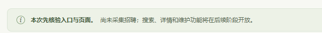
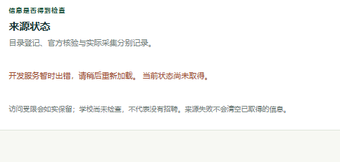
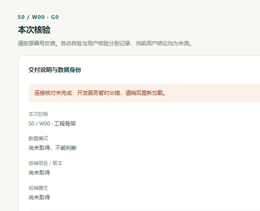
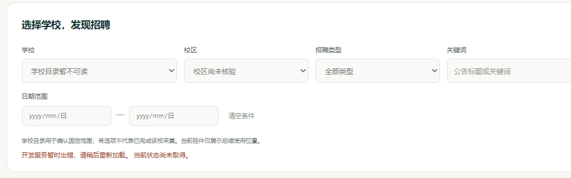
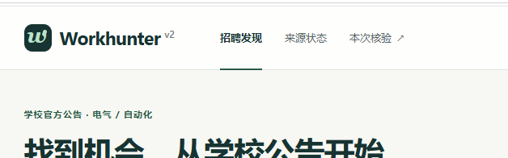

# M0 阶段验收反馈与问题汇报

反馈登记日期：2026-10-11，Asia/Shanghai。原阶段 S0 / G0 统一为 M0；[命名映射](M_NAMING.md)保留旧编号。既有核验单 [#1](https://github.com/caor3693-cmyk/Workhunter-v2.0/issues/1)、功能项 [#6](https://github.com/caor3693-cmyk/Workhunter-v2.0/issues/6)均为 Blocked/open，**本阶段未通过**。

本文件记录反馈登记轮次的原始结论；随后源码命名、说明和上传检查见 [M0 neat-freak 收尾](M0-NEAT-20261011.md)。它不改变下列用户结果，三个问题仍未完成修复复验。

## 用户原反馈

1. “之后所展示的页面就应该是最终的成品页面，不能塞入各种奇怪的说明框比如p123，主页保持简洁”
2. “p4中各个选项暂时未开放可选，且下方有报错我不知道这是不是当前的这个正常状态”
3. “p5中顶端显示有三个不同页，不应该在同一页中跳转，要做不同的子页面跳转。”
4. “以后每个阶段统一用M来表示，功能点X就是Mx这样表示。”

这是构建者转录用户本对话的真实反馈。未收到用户明确通过的检查保持未测；不会用截图里已打开网页推断其它操作已通过。

## 去重与实际问题单

当前仓库原有 #1—#19，没有同根因修复单。新建三项并分别关联 M0 #1 / 原功能 #6；p4禁用筛选复用已存在的 M1功能 #10，不重复新建同功能任务。

| 用户反馈 | 实际 Issue | 分级 / 状态 | 影响与处理边界 |
| --- | --- | --- | --- |
| p1—p3：主页混入开发说明、来源说明和核验框 | [#21 首页成品布局](https://github.com/caor3693-cmyk/Workhunter-v2.0/issues/21) | P1 / Ready / open | 当前用户明确要求，M0-02失败；详细说明移出主页，保留必要真实业务状态 |
| p2—p4：目录、状态、版本/数据身份读取错误 | [#22 开发API读取失败](https://github.com/caor3693-cmyk/Workhunter-v2.0/issues/22) | P1 / Ready / open | 阻塞M0-03/M0-06；先区分API、HTTPS通道、代理与配置根因，不能当作正常空库 |
| p5：三个导航只滚动同一页 | [#23 独立子页面](https://github.com/caor3693-cmyk/Workhunter-v2.0/issues/23) | P1 / Ready / open | 新增M0-07失败，独立页面须可直接打开/刷新/前后退，与主页修复联动 |
| p4：筛选控件禁用 | [既有#10](https://github.com/caor3693-cmyk/Workhunter-v2.0/issues/10) | P1 / Backlog / open，M1 | 原M0预留状态，功能尚未实施；不称筛选通过。后续按成品设计交付真实可操作筛选 |

每项已写明用户证据、实际/预期、版本与数据限制、负责模块、允许修改路径、关联功能/阶段及原编号复验判据。首页/导航共享文件由同一实施者整合；读取链路先定位，不扩大后置业务或放宽访问边界。

## 当前逐项结果

| 当前编号 | 原编号 | 用户反馈归类 | 依据 / 关联问题 |
| --- | --- | --- | --- |
| M0-01 | G0-01 | 未测 | 已打开产品页面；没有明确通过确认，读取问题关联#22。 |
| M0-02 | G0-02 | 失败 | 首页混入开发说明/核验区，错误与预留状态不易区分；#21、#22。 |
| M0-03 | G0-03 | 阻塞 | 后端身份与数据模式尚未取得；#22。 |
| M0-04 | G0-04 | 未测 | 未收到刷新、关闭后重开的明确结果。 |
| M0-05 | G0-05 | 未测 | 未收到手机/窄窗口操作的明确结果。 |
| M0-06 | G0-06 | 阻塞 | 当前后端版本/提交/dataset无法核对，且核验材料占主页；#21、#22。 |
| M0-07 | 本次新增 | 失败 | 顶部三项均同页锚点，用户要求独立子页；#23。 |

M0-02、M0-07为失败；M0-03、M0-06为阻塞；M0-01、M0-04、M0-05未测。M0-07是本次新增需求对应检查，不覆盖原六项。当前不是“全部失败”或“其它项目默认通过”，也没有完成修复复验。

三项P1保持开放，阻塞M0通过和最终发布。M1—M4可准备独立工作，但人工核验仍必须M0→M1→M2→M3→M4顺序，不越级关闭。

## p4 两种状态的解释

控件不可选是上一版M0骨架的预留实现，学校/校区/类型/关键词/日期等真实交互仍归M1 #10。它不能作为已完成功能；下一版展示采用最终产品布局，未可用控件不靠整页开发说明掩盖。

红色“开发服务暂时出错 / 当前状态尚未取得”不是正常空库。正常空库仍应成功读取目录、真实项目/commit/dataset，机会为0，来源尚未检查与新增未知有准确表达；连接失败意味着这次无法取得数据。登记时不带服务令牌的环回health只读探测发生连接错误；不能据此把截图当时的根因写死为某个进程或模块。具体故障在#22定位。

## 版本、数据与工程证据的边界

- 私有 Site：[当前入口](https://workhunter-v2-review.sage-candy-7999.chatgpt.site)；页面尚未修改或重发。
- 原已保存前后端代码：`288063243275eeb0530cc9b9743c1d11aa4cfbde`，版本0.1.0，运行阶段仍为旧S0/W00。
- 原交付dataset：`ds-05add5c6-e4e7-43a6-9bc3-89b5e4a4a10e`，empty；本次用户页面未取得实时身份，不能伪称它在失败当次已经回读一致。
- 2026-10-10的41 Python / 3代理测试、CI和Site HTTP成功为历史工程证据，见[S0初版包](S0.md)，不抵消本次用户失败/阻塞。
- 本轮只整理Issues、命名、模板与文档，未执行UI/API修复、采集、维护、重新部署或旧站切换。问题自验和用户复验仍未完成。

本轮资料自验已完成：GitHub回读的22个Issue标题、状态、优先级和阶段/状态标签与配置一致；原36项核验编号全部映射保留，新版共37项；汇报的相对链接可解析；五张归档截图与用户原文件的SHA-256一致。原生Project/Board/Roadmap的ID和URL仍为空。这些检查只证明登记与材料一致，不代表页面故障已修复。

## 截图材料

以下是用户提供的原截图，p1—p5按反馈顺序保留，没有修改内容。

## 后续修复与复验顺序

1. #22定位并恢复真实读取，提供Site实际接口/身份/断连恢复材料。
2. #21与#23整合最终主页布局及独立子页面；保留真实空库和错误语义，不填模拟招聘。
3. 开发自验后更新同一M0 #1及对应Issue，新版本按M0-02/M0-03/M0-06/M0-07复验；M0-01/M0-04/M0-05补测，其余受影响项回归。
4. 筛选实施仍归M1 #10，实际交付后按原对应M1编号核验。
5. 用户复验未到前保持open；PR用Refs。#19原生Project配置与#18正式发布继续Blocked，文档看板不冒充原生视图。

当前看板：15 Backlog、3 Ready、4 Blocked，Awaiting verification / In progress / Done均0，共22个实际Issue。新增问题的登记日是10-11，修复完成日和复验日均为空，不虚构排期达成。
