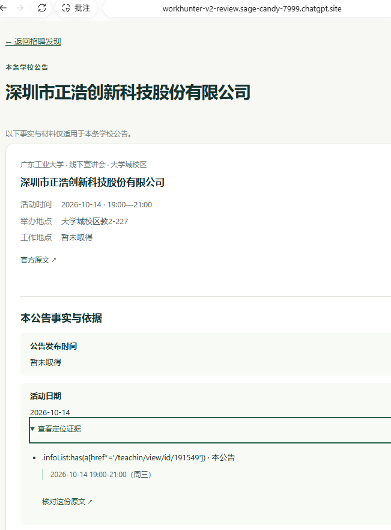
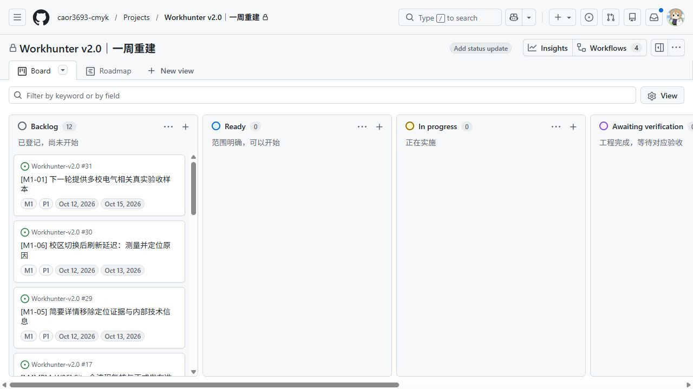

# M0/M1 第二轮用户验收与未解决反馈（2026-10-11）

**M0七项通过；M1五项通过、三项失败，M1尚未通过。#29/#30/#31均未解决，本轮没有实施修复或重发Site。** 用户明确授权： “我这里将提出我见到的问题，我没明确指出有问题的直接默认通过即可。” 本轮据此登记已交付M0/M1的未指出问题项；不声称每项另有点击回执，不推广到未实施的M2—M4。M0-01还保留此前单独“通过”回复。

## 原编号结果与历史保留

| 原编号 | 本轮结论 | 依据与待处理问题 |
| --- | --- | --- |
| M0-01 | 通过 | 先前逐项回复通过 |
| M0-02 | 通过 | 本轮明确授权：未指出问题的项目通过 |
| M0-03 | 通过 | 本轮明确授权：未指出问题的项目通过 |
| M0-04 | 通过 | 本轮明确授权：未指出问题的项目通过 |
| M0-05 | 通过 | 本轮明确授权：未指出问题的项目通过 |
| M0-06 | 通过 | 本轮明确授权：未指出问题的项目通过 |
| M0-07 | 通过 | 本轮明确授权：未指出问题的项目通过 |
| M1-01 | 失败 | #31：两校当前电气材料不足；更多学校列下一轮 |
| M1-02 | 通过 | 本轮明确授权：未指出问题的项目通过 |
| M1-03 | 通过 | 本轮明确授权：未指出问题的项目通过 |
| M1-04 | 通过 | 本轮明确授权：未指出问题的项目通过 |
| M1-05 | 失败 | #29：详情内部定位证据仍在 |
| M1-06 | 失败 | #30：刷新延迟未定位 |
| M1-07 | 通过 | 本轮明确授权：未指出问题的项目通过 |
| M1-08 | 通过 | 本轮明确授权：未指出问题的项目通过 |

原M0-02/07失败、M0-03/06阻塞和其余未测保留在[首次反馈](M0-FEEDBACK-20261011.md)、config.manual_review_history、[首次操作包冻结版本](https://github.com/caor3693-cmyk/Workhunter-v2.0/blob/02ae529ce4637be643b7751bddea7f07a5750509/docs/deliveries/M0-M1-REVIEW-20261011.md)及[结构化本轮回执](evidence/M0-M1-FEEDBACK2-20261011.json)，没有改写原现场。M0通过后才登记M1结果。当前操作仍使用[M0七项/M1八项原编号包](M0-M1-REVIEW-20261011.md)。

## 三项新问题：分析先于对策

| 未解决 Issue | 已知事实、未知项 | 下一轮对策与复验 |
| --- | --- | --- |
| [#29 简要详情内部证据](https://github.com/caor3693-cmyk/Workhunter-v2.0/issues/29) | 用户记录68截图与cards.js一致：字段/片段/附件输出locator折叠区，材料区带技术身份。原因已确认是展示层直接输出工程依据。 | W02-R4移除技术证据、定位器和内部材料身份；后台证据保留。详情保留事实、未知/冲突、有限正文、官方附件/原文。用68/31/40复验M1-05及手机/键盘。 |
| [#30 校区刷新延迟](https://github.com/caor3693-cmyk/Workhunter-v2.0/issues/30) | 用户体感明显延迟，无准确秒数。源码重新加载等待目录/摘要/查询；网络、接口、渲染与按钮等待都是待定位项，不能锁定根因。 | 10-12目标完成诊断：同条件至少30次冷/热、提交/重载、桌面/窄屏，分段计时；证据决定优化，10-13是修复/复验目标，非已达成承诺。保持草稿/晚响应/分页正确。原目标列表API p95≤1秒、卡片≤3秒仍未证明。 |
| [#31 多校电气真实样本](https://github.com/caor3693-cmyk/Workhunter-v2.0/issues/31) | 只读库：广工104=related14+unknown90；华工28全部unknown，近期0/临近0/历史27/日期未知1。其余八校未采集。现有华工学院材料不构成当前电气覆盖。 | 先补M1华工/广工当前、明确电气/自动化原文依据的真实样本与可见入口，按M1-01复验。下一轮目标至少3所固定学校各1条可核验当前电气公告，新增学校沿用M2/W03 [#12](https://github.com/caor3693-cmyk/Workhunter-v2.0/issues/12)，10-15为后续目标；本轮未启动M2。 |

诊断于2026-10-11T16:29:57.728401+08:00只读执行，DB前后SHA-256同为`107a3d29ad7d1a19927e97e71bb0824cdacc458eb3cfa06e857c45a7a155e3b8`。不是新的抓取/维护轮次。华工无近期数据与用户看到只有广工一致；不能用132条总数或unknown代替电气相关覆盖。此前Site HTTP仅少量请求，不能作为远端p95；后续诊断不得凭本地单并发成绩宣告Site提速。

多校计划分阶段：M1前门只复验两校当前材料缺口；至少3校属于后续M2测试目标，由#12实施。不要求M1先实现M2，不形成循环依赖；本单后续部分在M1部分通过后仍可保持open。固定十校、电气/自动化方向保持；学校、公司名、会场和历史公告不能替代岗位/专业原文依据。unknown保留但不计入明确电气样本；公开来源受限就说明缺口，不绕过登录/验证码或改用fixture凑数。

用户截图归档（原件字节/哈希一致）：

## 看板与阶段关闭

[原生 Board](https://github.com/users/caor3693-cmyk/projects/5/views/1) / [Roadmap](https://github.com/users/caor3693-cmyk/projects/5/views/2)现已建立在v2专用私有Project5，未改旧Workhunter/Creator项目。26个本仓库实际Issue全部导入，Status/Stage/Priority/Start date/Target date逐项回读；Board按Status分列，Roadmap实际UI保存Stage分组与起止日期。#19技术配置已完成并有实际回执。

Done/closed9项：#1/#6/#8/#11/#19/#21/#22/#23/#24。其中7个产品相关项按本轮明确授权及对应通过检查登记（#11刷新延迟交#10/#30跟踪）；#19原生项目和#24可信治理按实际技术复核完成。Blocked/open5项：#2/#7/#9/#10/#18。Backlog/open12项含三项新反馈，其余未实施M2—M4保持原排程和未测状态，不随本轮默认通过规则结案。

原生Board实际显示三项新反馈，均在Backlog/open；已通过项在Done列：

## 实施顺序、共享文件与范围

下一批先由同一整合者诊断#30并修#29（共享cards/home/store/API只单人整合，必要代理联动明确登记R1）；另一个独立包W01-R3补#31的两校真实电气材料。最多两个实施包，当前活动包为0。先形成根因与选择依据，再实施对策、局部源码清理、实际neat-freak、相关回归、推送和SHA/PR/CI回读，最后提供原编号复验。超过两校的#12/W03保持后续阶段，实施前走可信路径登记，不改现有checker自我放行。

当前PR仍[#28](https://github.com/caor3693-cmyk/Workhunter-v2.0/pull/28)，可信base `ae261c856761f84904430211b82ac7a42f689e4e`，R1/R2/W01-R3/W02-R4/R5五包，保持完整PR检查，不按W00检查全部工作。

## neat-freak 与身份边界

实际读取本机neat-freak **3.0.1**及四参考，SKILL SHA-256 `fb645274f18473740b389efb89b51ef4e58ddefaf26a4b1b43a9d82e4c848b31`。

| 事实面 | 本轮实际状态 |
| --- | --- |
| 代码 | verified-current：检查详情/首页/查询及本轮diff；应用源码无改动，无需制造局部清理改动。纯管理材料检查配置/编号/链接、diff和可信完整范围；本次CI另回读。 |
| 运行 | 本地只读version回读b6300f4/real/同dataset；Site仍保存版本4。三项产品问题pending。review.js仍有交付时“结果未测”文案，下一产品候选应同步；当前用户结果以本报告/Issue/Board为准。 |
| 文档 | changed-verified：STATUS、BOARD、ROADMAP、PROJECT_SETUP、操作包、反馈规则及config同一结果，原历史保留。 |
| 规则 | verified-current：本轮用户明确授权优先，作为仅当前M0/M1例外记录；全局不以沉默判通过、可信治理/两包/共享约束保持。未改AGENTS/checker/合同给业务放行。 |
| 记忆 | generated-read-only：无长期记忆写入；旧项目上下文与当前v2证据分开。 |
| 工作区 | 只处理当前v2工作分支；原材料/用户截图/数据库/备份/凭据/运行验收宿主保留。已归档内容的本轮可再生助手脚本与请求副本按用户授权清理，不删旧项目或未合并工作。 |

真实来源与哈希见[M1实采](evidence/M1-REAL-SOURCES-20261011.json)，隔离样例见[原操作包](M0-M1-REVIEW-20261011.md)。应用/Site/前后端源码仍`b6300f4991d4c9a36ecf8f425a6de578c0106275`；本轮管理文档基线`02ae529ce4637be643b7751bddea7f07a5750509`，最终上传SHA与CI以PR实际回执为准；不混称本次管理提交为Site新构建。M1工程证据此前齐备不等于本轮用户通过；main/PR20未合并，正式发布未执行。

本轮资料验证：26项Issue及原生字段、15个原编号结果、37个稳定检查号、63个相对链接、两张截图哈希与DB/应用不变检查通过；diff格式核对通过。清理了42份本轮可再生助手脚本/请求/正文副本，共171625字节；唯一回执、运行资产和用户原件保留。最终可信完整范围和GitHub SHA/CI另附PR回执。
