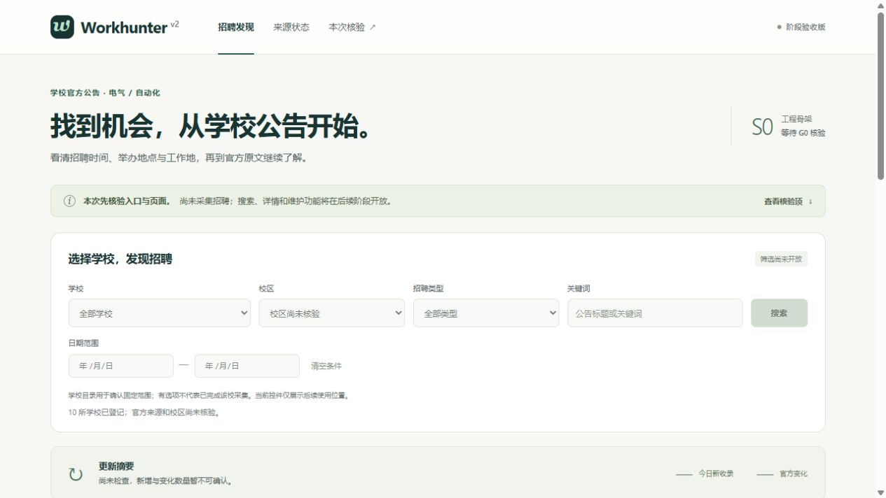
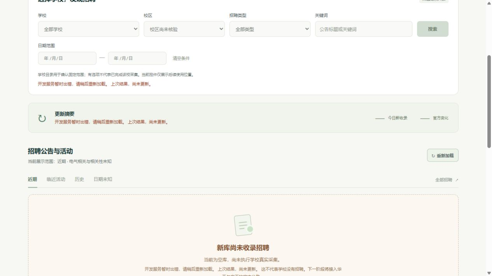

# S0 / W00 交付与 G0 待验包

实际开发、自验与私有 Site 保存日：2026-10-10，Asia/Shanghai。原目标：2026-10-11。实施 [#6](https://github.com/caor3693-cmyk/Workhunter-v2.0/issues/6)，既有 Gate [G0 #1](https://github.com/caor3693-cmyk/Workhunter-v2.0/issues/1)，[draft PR #20](https://github.com/caor3693-cmyk/Workhunter-v2.0/pull/20)。两项 Issue 保持 open / Awaiting verification，六项用户结论均未测。

## 入口、构建与数据

| 项目 | 实际交付 |
| --- | --- |
| Site | [Workhunter v2 阶段验收](https://workhunter-v2-review.sage-candy-7999.chatgpt.site)；owner-private，需 owner 的 ChatGPT 登录 |
| 产品 / 阶段 | Workhunter-v2.0 / 0.1.0 / S0-W00 |
| 前端 commit | [288063243275eeb0530cc9b9743c1d11aa4cfbde](https://github.com/caor3693-cmyk/Workhunter-v2.0/commit/288063243275eeb0530cc9b9743c1d11aa4cfbde) |
| 后端 commit | 288063243275eeb0530cc9b9743c1d11aa4cfbde，与 Site 读取结果一致 |
| 数据集 | ds-05add5c6-e4e7-43a6-9bc3-89b5e4a4a10e |
| 数据模式 | empty；真实新库，0 条招聘；无演示招聘、无真实采集成功记录 |
| 初始化时间 | 2026-10-10T22:54:26.261043+08:00 |
| 数据库 SHA256 | 0a66425cab59bf5732c0c53e22164fd39e7e5969590bb3689139b531360e8951；重复初始化及 API 重启前后不变 |
| 真实 Site 同源读取核验 | 2026-10-10T23:22:43.466294+08:00 |
| Site project | appgprj_6aca4fbe4c1481918047d279e9653ccc |
| Site version | appgprj_6aca4fbe4c1481918047d279e9653ccc~appgver_7bc14d93f34881919ab22de24ebb944e |
| Site deployment | appgdep_6aca55c5b52881919320ff6973c27146；succeeded，runtime env revision 1 |

本包及后续管理文档提交不替代已冻结的前后端代码身份。公开包只放脱敏结果；不放服务端 secret、Site 服务访问令牌、内部宿主地址或私有日志。

## 当前可操作内容与运行边界

页面可打开学校目录、来源状态、空结果说明、本次核验及数据身份，重新加载真实只读数据，并复制 G0 反馈。搜索、日期视图、招聘详情及维护功能明确标为后续开放。十校目录登记不表示十校已采集；来源均为 pending / not_checked，新增与变化未知，显示破折号，API 为 null。

原生前端与固定同源代理运行在私有 Site；Python/FastAPI、SQLite 与后续独立 worker 保留在隔离开发宿主。代理只接受约定的 GET 接口，服务令牌留在 Site 服务端，不转发浏览器登录信息。开发 API 强制服务鉴权，访客 GET 不建库、迁移、采集或写业务记录。

本次 HTTPS 开发通道依赖本机与 API / 通道进程在线；关闭、休眠或通道断开会使实时读取失败。它是临时验收连接，稳定无人值守宿主与自然调度仍属后续阶段。Site URL 本身可复用；不能据此宣称 24 小时持续维护。

## 已实际执行的工程自验

| 自验 | 结果与具体限制 |
| --- | --- |
| Python / 存储 / API / 范围反例 | 41 passed；覆盖显式建库、重复初始化、残缺/损坏/缺失库 503、GET 无写入、鉴权、参数/分页与越界重命名反例；合成数据只用于测试 |
| 同源代理边界 | 3 passed；约定路径、拒写、固定 HTTPS 上游、禁止转发访客凭据、重定向/非 JSON/超大响应拒绝 |
| GitHub CI | [run 38062386958](https://github.com/caor3693-cmyk/Workhunter-v2.0/actions/runs/38062386958) success，commit 288063243275eeb0530cc9b9743c1d11aa4cfbde |
| 真实 HTTPS 开发 API | 带本次授权服务令牌的 health/version 200；不带令牌 401，身份与 dataset 对上 |
| 真实私有 Site HTTP | HTML 与六个同源 API 全部 200；HTML 前端与 version 后端均为 288063243275eeb0530cc9b9743c1d11aa4cfbde，六个 API dataset/data_mode 对上；[脱敏回执](evidence/S0-site-http.json) |
| 真实 Site 负例 | POST catalog 405；POST admin commit 404；任意 URL 代理路径 404 |
| 本机同构浏览器 | 同冻结前端连接真实环回 API；目录十校、来源展开、重新加载、数据身份与准确空库说明通过；桌面可视宽度/scrollWidth=1265/1265，390px 窄屏=375/375 |
| 本机真实断连 / 恢复 | 仅停止本次独立 API 后重新加载，显示错误与“上次结果，尚未更新”；恢复 API 后重新加载正常，commit/dataset/数据库散列保持不变 |
| 真实 Site 浏览器 | 已打开平台登录页；内置浏览器无 owner 平台会话，登录后 UI 操作尚未自验，留给用户按 G0 操作；HTTP 服务访问不冒充浏览器用户身份 |
| 用户 Gate | G0 六项均未测；G1—G4 未测，无用户通过记录 |
| 真实官网采集 / 维护 / 调度 / MCP | 未执行；refresh 与 worker 明确退出 2 并说明未实现，不生成成功运行记录 |
| 原生 Project / 分支保护 | #19 通道阻塞，ID/URL null；连接无管理权限读取 branch protection，rulesets 返回空，不称平台保护已强制 |
| 正式发布 / 旧站切换 | 未执行；#18 保持 Blocked |

只有工程检查通过；本阶段尚未获得用户验收。自然调度、业务恢复、官网覆盖与线上正式发布各有自己的后续证据要求。

本机截图仅证明同构前端与真实开发 API 的工程自验，不是登录后真实 Site 截图：





## G0 原编号用户操作

先用 Site owner 账号完成正常 ChatGPT 登录，再使用以下入口。若账号/环境阻塞，请记录对应编号“阻塞”；无需输入开发令牌或执行服务器命令。当前不提供招聘演示、官方公告样例或维护写入口；这符合 S0 骨架范围，真实两校场景在 S1 提供。

| 编号 | 场景材料 / 原文 / 数据模式 | 用户操作 | 预期 | 用户结论 |
| --- | --- | --- | --- | --- |
| G0-01 | [Site 首页](https://workhunter-v2-review.sage-candy-7999.chatgpt.site)；真实隔离空库，平台 owner 登录 | 打开本次 Site 链接。 | 正确进入 Workhunter v2 骨架；没有跳到旧站、访问错误或空白页。 | 未测 |
| G0-02 | [首页](https://workhunter-v2-review.sage-candy-7999.chatgpt.site)、[来源状态](https://workhunter-v2-review.sage-candy-7999.chatgpt.site/#sources)；真实空库/未知摘要，断连恢复自验证据见交付包 | 查看首页的数据区域及未完成入口。 | 空库、加载、错误、尚未实现各有准确说明；不会显示虚构招聘或假成功。 | 未测 |
| G0-03 | [数据身份](https://workhunter-v2-review.sage-candy-7999.chatgpt.site/#review)；无演示，empty 与十校未检查 | 若提供演示场景，按指定入口查看，再回主入口。 | 演示或隔离样例能与真实数据区分；没有把样例宣称为学校真实覆盖。未提供演示时确认主入口的数据模式即可。 | 未测 |
| G0-04 | 同一 Site 首页 URL；冻结构建 2880632、同一 dataset | 刷新页面，关闭后重新打开同一链接。 | 地址可复用，仍进入同一项目；没有丢失页面或意外切回旧版本。 | 未测 |
| G0-05 | 同一首页；本机同构 390px 自验材料，真实手机 Site 操作待用户 | 用手机或窄窗口打开首页。 | 文字与主要入口可读、可点击，不靠横向拖动才能使用。 | 未测 |
| G0-06 | [核验区](https://workhunter-v2-review.sage-candy-7999.chatgpt.site/#review)与 [S0 包](https://github.com/caor3693-cmyk/Workhunter-v2.0/blob/codex/s0-w00-site-foundation/docs/deliveries/S0.md) | 核对交付包是否给出构建身份、数据模式、自验结果和下一阶段说明。 | 能明确知道正在核验什么、哪些尚未实现；没有把文档或演示写成真实采集完成。 | 未测 |

G0-02 的真实断连与恢复由构建者完成，不要求用户制造网络故障；本次用户确认空库、未知状态与尚未开放入口是否清楚。无官网样例是本阶段事实，不能把空库当作“学校没有招聘”。

## 反馈模板

```text
Gate：G0
本次 Site / 版本 / commit / dataset：沿用本次交付包，或说明实际变化
G0-01：通过 / 失败 / 阻塞 / 未测；实际看到：
G0-02：通过 / 失败 / 阻塞 / 未测；实际看到：
G0-03：通过 / 失败 / 阻塞 / 未测；实际看到：
G0-04：通过 / 失败 / 阻塞 / 未测；实际看到：
G0-05：通过 / 失败 / 阻塞 / 未测；实际看到：
G0-06：通过 / 失败 / 阻塞 / 未测；实际看到：
失败或阻塞的操作位置：
截图 / 原文链接（可选）：
```

用户回复先按编号、场景及根因查重，再补建或更新反馈 Issue，写明关联 #6 / #1、版本/dataset、影响与允许修改路径；修复后按原编号复验。无反馈保持待验，PR 使用 Refs，不自动关闭。

## 管理阻塞与下一阶段

原生 Project / Board / Roadmap 当前没有可调用的 Projects 工具，现有 CLI 认证失效。[#19](https://github.com/caor3693-cmyk/Workhunter-v2.0/issues/19) 保持 Blocked，不重复登录，仓库 [BOARD](../BOARD.md) 与 [ROADMAP](../ROADMAP.md) 用于可继续的工作。当前为 15 Backlog、2 Awaiting verification、2 Blocked、0 Done；没有原生 Project 字段写入。

下一阶段 S1 / W01 + W02，原目标 10-12—10-13：先 #7 两校列表发现与逐页持久化，再日期/地点证据和原生招聘阅读流程。等待 G0 反馈可做独立工作，G1 提交与用户结论仍须依赖 G0 顺序通过。所有 Gate、必需反馈和发布准备完成前，#18 不执行正式部署，旧库、旧站和旧资产保留。
